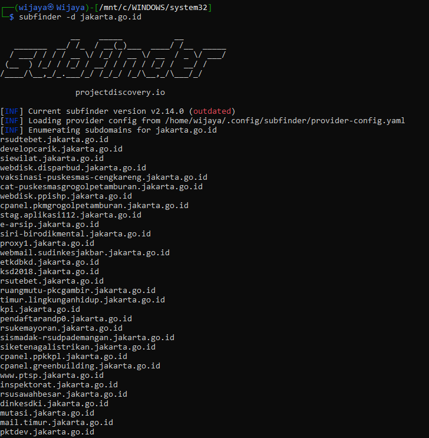
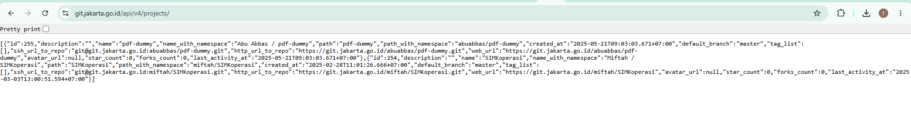
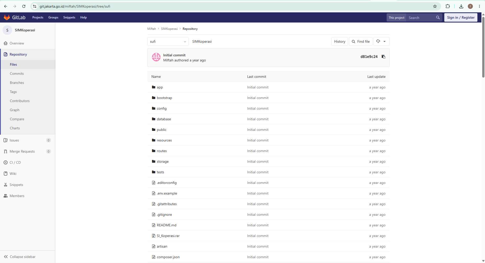
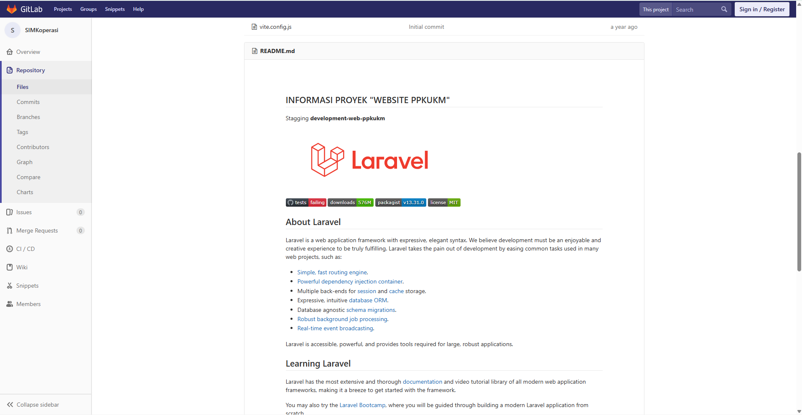
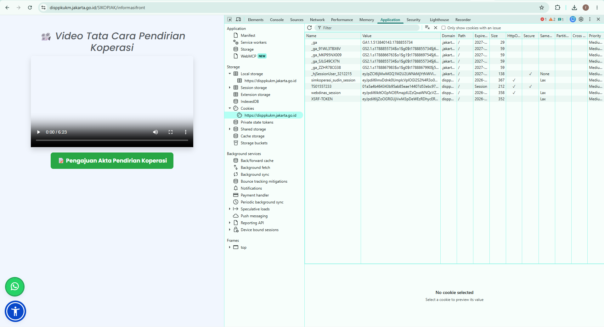
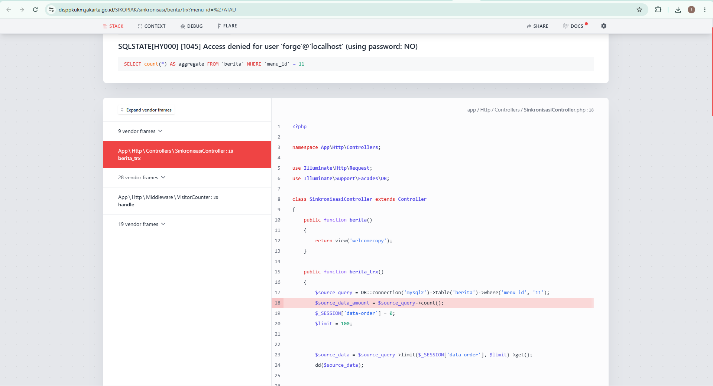

# Web Application & Infrastructure Security Assessment

> **Laporan hasil security assessment** terhadap sistem informasi pada lingkungan pemerintahan `.go.id`.
> Assessment dilakukan dengan prinsip **non-destructive security testing** dan berfokus pada identifikasi, validasi, dokumentasi, serta rekomendasi remediasi kerentanan kritis.

## Informasi Assessment

| Item | Detail |
|---|---|
| Nama | Faril Bily Wijaya |
| Target | `git.jakarta.go.id` & `disppkukm.jakarta.go.id` (SIKOPJAK) |

---


## Ringkasan Finding

| ID | Finding | Target | Severity | Status |
|---|---|---|---|---|
| 01 | Public Repository Exposure (Source Code Disclosure) | `git.jakarta.go.id` | **MEDIUM (5.3)** | 
| 02 | Mode debug aktif di produksi menampilkan informasi internal  | `disppkukm.jakarta.go.id` | **MEDIUM (5.3)** | 


---

# 01 — Public Repository Exposure (Source Code Disclosure)

- **Title:** Public Repository Exposure Leading to Full Source Code Disclosure
- **CWE:** CWE-527: Exposure of Version-Control Repository to an Unauthorized Control Sphere
- **CVSS 3.1 Score:** 5.3 (Medium) AV:N/AC:L/PR:N/UI:N/S:U/C:L/I:N/A:N

## Description
Kerentanan eksposur informasi kritikal berupa kebocoran repositori kode sumber (*Source Code Disclosure*) ditemukan pada infrastruktur Pemerintah Provinsi DKI Jakarta (`*.jakarta.go.id`). Melalui tahap *reconnaissance* yang sistematis menggunakan perangkat enumerasi otomatis seperti **Sublist3r, Amass, dan Subfinder**, berhasil diungkap keberadaan server GitLab internal di `git.jakarta.go.id`. Kesalahan konfigurasi pada visibilitas proyek memungkinkan penemuan proyek SIKOPJAK secara anonim (*unauthenticated*) melalui *endpoint* API publiknya.

## Impact
Penyerang eksternal anonim tanpa hak akses apa pun ke sistem dapat mengeksploitasi celah ini untuk mengunduh 100% *source code* aplikasi SIKOPJAK secara utuh. Kepemilikan penuh atas source code ini berfungsi sebagai pengganda ancaman (*force multiplier*) melalui simulasi serangan *white-box*. Penyerang dapat mempelajari pengendali logika aplikasi, memetakan celah *Insecure Direct Object Reference* (IDOR), hingga memilah rute mana saja yang luput dari proteksi *middleware* autentikasi. Hal ini mengancam integritas data operasional Dinas PPKUKM DKI Jakarta secara masif.

## POC (Proof of Concept)

**Step 1:** Penyerang memulai *reconnaissance* pada lingkup target `*.jakarta.go.id` menggunakan perangkat pemindai otomatis yang kemudian berhasil memetakan keberadaan *subdomain* repositori.


**Step 2:** Antarmuka web GitLab mengharuskan *login*. Namun, penyerang memanfaatkan standar arsitektur GitLab dengan menembak *endpoint* API publik secara anonim: `curl -s "https://git.jakarta.go.id/api/v4/projects?per_page=20"`. Respons JSON dari API membocorkan Project ID 254 (`miftah/SIMKoperasi`).


**Step 3:** Penyerang mengakses tautan repositori secara langsung: `https://git.jakarta.go.id/miftah/SIMKoperasi/tree/sufi`.

*Tangkapan layar di atas menunjukkan akses penuh tanpa batas. Keberadaan tombol "Sign in / Register" membuktikan akses unauthenticated.*

**Step 4:** Bukti bahwa repositori ini adalah kode sumber SIKOPJAK dikonfirmasi melalui teks `web-ppkukm` di dalam `README.md` serta kecocokan identitas kuki sesi `simkoperasi`.



## Recommended Fix
1. **Ubah Visibilitas Repositori (Prioritas Utama):** Segera ubah setelan visibilitas proyek `miftah/SIMKoperasi` di server GitLab dari "Public" menjadi **"Private"**.
2. **Kunci Akses API Anonim:** Konfigurasikan server GitLab agar menonaktifkan pencantuman daftar proyek publik (*Public Directory*).

---

# 02 — Mode debug aktif di produksi menampilkan informasi internal (disppkukm.jakarta.go.id)

- **Title:** Active Debug Code (`dd()`) Accessible in Production Environment
- **CWE:** CWE-489: Active Debug Code, CWE-209
- **CVSS 3.1 Score:** 5.3 (Medium) `AV:N/AC:L/PR:N/UI:N/S:U/C:L/I:N/A:N`

## Ringkasan
Aplikasi SIKOPJAK di produksi berjalan dengan `APP_DEBUG=true` dan `APP_ENV=dev`. Ketika endpoint `/sinkronisasi/berita/trx` menghasilkan exception, halaman debug Laravel Ignition ditampilkan lengkap kepada pengunjung anonim.

## Langkah Reproduksi
1. Jalankan di web:
   ```
   https://disppkukm.jakarta.go.id/SIKOPJAK/sinkronisasi/berita/trx
   ```
   
2. Respons berupa HTTP 500 dengan halaman Ignition yang memuat:
   - Exception `Illuminate\Database\QueryException` beserta pesan SQL (`SQLSTATE[HY000] [1045] Access denied for user 'forge'@'localhost'`)
   - Versi PHP 8.3.8 dan Laravel 10.48.29
   - Tab Context dengan `App Debug: true` dan `App Env: dev`
   - Potongan kode `app/Http/Controllers/SinkronisasiController.php` baris 18
   

**Hasil yang diharapkan:** halaman error generik tanpa detail internal.

## Dampak
Informasi versi framework, nama pengguna basis data, struktur query, dan path internal server membantu penyerang merencanakan serangan lanjutan. Dalam pengujian ini tidak ditemukan bukti bahwa password atau variabel `.env` rahasia ikut terekspos.

## Catatan Teknis
Baris 24 pada method `berita_trx()` memanggil `dd($source_data)`. Baris ini hanya dicapai jika query berhasil. Pada kasus ini query gagal di baris 18, sehingga halaman error yang tampil berasal dari exception dan debug mode, bukan dari `dd()`.

## Perbaikan
1. Set `APP_DEBUG=false` dan `APP_ENV=production`.
2. Hapus `dd()`, `var_dump()`, dan `print_r()` dari kode sebelum deployment.
3. Tangani exception database dengan halaman error generik dan pencatatan log internal.

---

## References
- [1] [CWE-527: File and Directory Information Exposure](https://cwe.mitre.org/data/definitions/527.html)
- [2] [CWE-489: Active Debug Code](https://cwe.mitre.org/data/definitions/489.html)
- [3] [CWE-215: Information Exposure Through Debug Information](https://cwe.mitre.org/data/definitions/215.html)
- [4] [GitLab Docs: Public Projects Visibility](https://docs.gitlab.com/ee/public_access/public_access.html)
